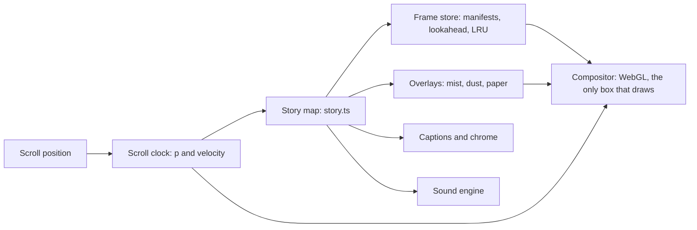

# Homeward: website architecture

One fixed canvas plays the film. Scroll sets a single progress value p, and the canvas, the captions and the sound all read it, so scrubbing back replays everything exactly.

The compositor is the only box that draws. The other boxes prepare what it needs or react to the same p; the manifests are the JSON written by the import script, and the anchors are the ones you set in story.ts.

**How the clips are played**

| Method | Reverse scrubbing | Weight | Effort | Verdict |
| --- | --- | --- | --- | --- |
| Scrub a video element by currentTime | Uneven: seeking lands on keyframes unless every frame is one | Tens of MB per clip when every frame is a keyframe | Low | Prototype only |
| Image sequence drawn in WebGL | Exact: any frame, either direction, neighbours blend | About 51 MB at the 1440 tier, loaded a chapter at a time | Medium | Chosen |
| WebCodecs decode to canvas | Good | Small files | High, and browser support still varies | Later, if weight matters |

**Decisions**

- Stack: Next.js App Router, TypeScript, raw WebGL 1 and CSS modules, with no scroll or animation libraries.
- Smoothness: 570 stored frames feel continuous because the compositor blends the two frames either side of the fractional index.
- Loading: the current chapter and the next two, nearest first; the 768 tier on phones; first paint is the poster plus 24 frames, under 1.5 MB.
- Joins: push, portal and rect last 12 frames each, are pure functions of their own time t, and are exactly zero outside it. The pupil and photograph positions live in story.ts as anchors.
- Accessibility: reduced motion removes smoothing lag, overlays and breathing and turns every join into a cross-dissolve; with JavaScript off, the poster and the ten captions remain.
- Hosting: static files behind any host; give public/frames long immutable cache headers and rename a clip's folder to bust it.
